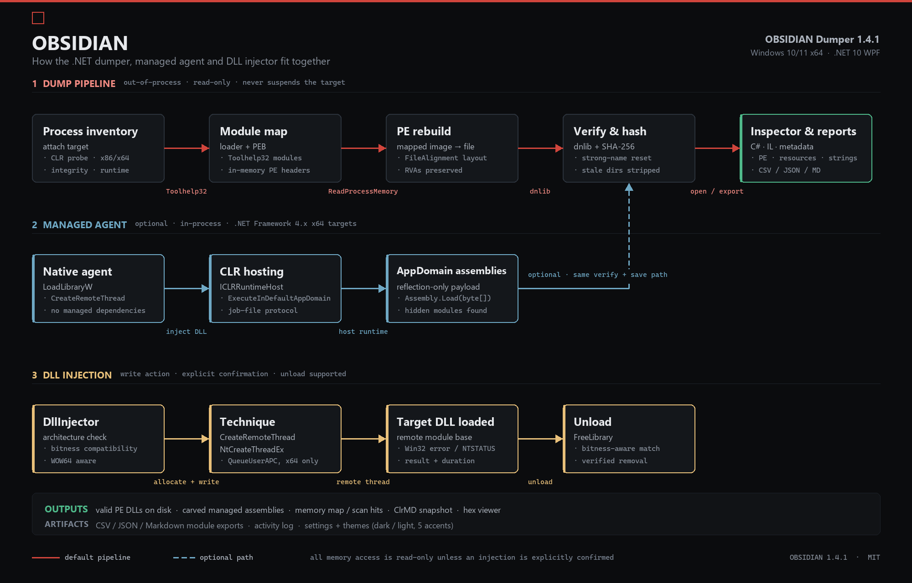

# OBSIDIAN — architecture



This document explains how OBSIDIAN turns a running CLR process into readable
files and code, how the injection stack works, and why the engine, UI and
settings are built the way they are.

## 1. Design goals

| Goal | Consequence |
|---|---|
| Never break the target | Read-only dump engine, no suspension, no thread injection for the default dump path; injection is a separate, explicit, confirmed feature |
| Produce valid files, not blobs | Real PE reconstruction with preserved RVAs, then independent verification |
| Cover every classic technique | Out-of-process memory reconstruction, in-process managed agent **and** native DLL injection |
| Explain what it found | Metadata, IL, C#, strings, references, sections, protector hints |
| Be operable | Scriptable CLI, deterministic output naming, structured logging, calm errors, persisted settings |
| Look like a product | Runtime dark/light themes, five accent presets, sectioned settings, exports and keyboard workflow |

Non-goals: defeating VM-based protectors, unpacking native packers, or running
code from the dumped assembly. Injection exists to load *instrumentation you
choose*, not to bypass licensing.

## 2. Components

```
┌──────────────────────────── OBSIDIAN.exe (WPF, net10.0-windows) ─────────────────────────────┐
│ ShellWindow · TargetsView · WorkspaceView · InspectorView · InjectView · LogView · SettingsView│
│ ShellViewModel → Targets / Workspace / Inspector / Injection / Log / Settings view models      │
│ Services: ThemeService (dark/light/system + accents), SettingsStore (schema v2), AppInfo        │
└───────────────▲───────────────────────────────────────────────▲───────────────────────────────┘
                │ public engine API                             │ ILogSink / events
┌───────────────┴───────────────────── Obsidian.Dumper.Core ────┴───────────────────────────────┐
│ ProcessDiscovery · RemoteProcess · ProcessSecurity · ProcessControl                           │
│ ModuleDumper · DllInjector · DeepDumper · TargetSession · PeImageLayout (shared)              │
│ AssemblyInspector · IlFormatter · DecompilerService · ProtectionAnalyzer · LogBus             │
└───────┬───────────────────────┬───────────────────────┬───────────────────────┬────────────────┘
        │ dnlib 4.4             │ ILSpy 9.1             │ P/Invoke              │ remote memory
┌───────▼────────┐    ┌─────────▼─────────┐    ┌────────▼────────────┐   ┌──────▼──────────────┐
│ metadata model │    │ C# decompilation  │    │ kernel32 / ntdll    │   │ target process      │
└────────────────┘    └───────────────────┘    └─────────────────────┘   └─────────────────────┘
                                                      │ optional deep dump / injection
                                ┌─────────────────────▼──────────────────────┐
                                │ Obsidian.Injector.x64.dll (native)         │
                                │ Obsidian.Dumper.Payload.dll (net48 agent)  │
                                └────────────────────────────────────────────┘
```

Project responsibilities:

| Project | Target | Role |
|---|---|---|
| `Obsidian.Dumper.Shared` | source shared | Portable PE parsing/rebuild used by the engine **and** the agent. No Span, no BCL packages. |
| `Obsidian.Dumper.Core` | net10.0 | All engine logic, Win32 interop, injection, dnlib/ILSpy integration. |
| `Obsidian.Dumper.Payload` | net48 | Agent executed inside .NET Framework targets. |
| `Obsidian.Dumper.Native` | C++ x64 | Loader that hosts the agent via the CLR hosting API. |
| `OBSIDIAN` | net10.0-windows | WPF UI (MVVM, no framework dependency, runtime theming). |
| `Obsidian.Dumper.Cli` | net10.0 | Headless client (`list`, `info`, `modules`, `dump`, `deep`, `inspect`, `inject`, `unload`, `token`, `diag`, `readtest`). |
| `Obsidian.Dumper.Tests` | net10.0 | Executable verification harness (213 checks). |

## 3. Process access

`RemoteProcess.TryOpen` first asks for `PROCESS_QUERY_INFORMATION | PROCESS_VM_READ`
and falls back to `PROCESS_QUERY_LIMITED_INFORMATION | PROCESS_VM_READ`. Query
rights are needed for token inspection; VM_READ for the dump. Injection adds
`VM_WRITE | VM_OPERATION | CREATE_THREAD` only for the explicit injection path and
only for the duration of the operation.

Memory reads are chunked (1 MiB). On failure the reader retries the window page
by page, zero-filling only the pages that are genuinely unreadable. This matters
because **.NET assemblies use 0x2000 section alignment**, leaving reserved gaps
between headers and the first section; a naive single `ReadProcessMemory` of
`SizeOfImage` fails at the first gap and would hand the rebuild a zeroed image.
`ReadInto` validates ranges up front so a bad caller cannot corrupt memory.

Module discovery uses `Toolhelp32Snapshot(TH32CS_SNAPMODULE | TH32CS_SNAPMODULE32)`
which also works from a 64-bit host for 32-bit targets. Managed detection is done
by parsing the mapped image: DOS/NT headers → data directory #14 → CLI header →
metadata root signature `BSJB` → runtime version string (`v4.0.30319`,
`v2.0.50727`, …).

The command line is read from the target PEB (`NtQueryInformationProcess` for
x64, the documented `ProcessWow64Information` query + 32-bit PEB for WOW64
targets), including the 32-bit PEB for WOW64 targets. Integrity levels come from
the token's mandatory label SID (pointer + `GetSidSubAuthority`), not from a byte
scan.

## 4. PE reconstruction

Two layouts matter:

- **File image**: section content at `PointerToRawData`, headers on `FileAlignment`.
- **Mapped image**: section content at `VirtualAddress`, headers on `SectionAlignment`.

`PeImageLayout.Rebuild` converts mapped → file:

1. Read and validate DOS/NT/optional headers, 16 data directories, section table.
   All offsets are range-checked (this is untrusted input from another process).
2. Compute `SizeOfHeaders = align(max(SizeOfHeaders, sectionTableEnd), FileAlignment)`.
3. Walk sections in order; for each section with content:
   - `rawSize = align(VirtualSize, FileAlignment)` (or the larger of
     VirtualSize/RawSize when `TrimPadding` is off),
   - `rawPointer = cursor`,
   - copy `rawSize` bytes from `mapped[VirtualAddress]` (or what is readable),
   - write the new `SizeOfRawData`/`PointerToRawData` back into the section header.
4. Zero `CheckSum`, normalise `FileAlignment`, fix `SizeOfHeaders`.
5. Optionally clear the debug and bound-import data directories.

RVAs are preserved, so every metadata token, import thunk and the entry point
stay valid. The result loads in dnlib, ILSpy, `Assembly.LoadFile` and runtime
tooling. `Characteristics` is read from the COFF header (`peOffset + 22`) — the
1.0.0 tree read it from the optional header, which misclassified every real DLL.

Strong names cannot survive a memory dump (the signature covers the original file
layout), so the CLI header's `StrongNameSignature` RVA/size and the
`STRONGNAMESIGNED` flag are cleared. This is why verification is done **after**
the rewrite: dnlib must still find metadata, types and method bodies.

Verification counts types and methods and reports them in the log
(`ok · 9 types · 24 methods · ObsidianTestTarget 1.1.0`). A file that does not
verify is still written (it may be useful evidence) but is flagged.

## 5. Dump engine

`ModuleDumper` runs modules through a bounded parallel worker pool
(`MaxDegreeOfParallelism` from settings), with cancellation between modules. For
each module it reads the mapped image, rebuilds it, optionally verifies it with
dnlib, computes SHA-256 and writes the file using the configured overwrite policy:

- `Rename` (default) — collision-safe `name_2.dll`, race-free via `CreateNew`,
- `Overwrite` — replace the existing file,
- `Fail` — refuse and report "the output file already exists" without touching
  the existing file.

The legacy `DumpOptions.Overwrite` boolean is a compatibility shim that maps onto
the policy.

## 6. Deep dump protocol

```
host                                     target
 │  copy agent DLL + payload to work dir
 │  write obsidian.job (payload, type, method, output)
 │  OpenProcess(CREATE_THREAD|VM_*)
 │  VirtualAllocEx + WriteProcessMemory(path)
 │  CreateRemoteThread(LoadLibraryW) ───► DllMain: DisableThreadLibraryCalls
 │                                        CreateThread(AgentThread)
 │  WaitForSingleObject(thread)           AgentThread:
 │                                         read obsidian.job next to the DLL
 │                                         ICLRRuntimeHost::ExecuteInDefaultAppDomain
 │                                          └─► PayloadEntry.DumpAll(output)
 │                                               AppDomain.CurrentDomain.GetAssemblies()
 │                                               Marshal.GetHINSTANCE(module) → rebuild
 │                                               write files + manifest
 │  poll obsidian.result ◄──────────────── write status/HRESULT
 │  read manifest, update the inspector
```

Design notes:

- The job file avoids passing more than one pointer through `CreateRemoteThread`.
- The agent never unloads itself (`FreeLibraryAndExitThread` inside a thread
  created from `DllMain` can deadlock on the loader lock).
- The native `DllMain` now fails the load deterministically when the agent thread
  cannot be started, instead of leaving a half-loaded DLL.
- Return codes are explicit: `framework <HRESULT> <exitCode>`, `error <reason>`,
  `unsupported coreclr`. `0x80131023` ("CLR has been disabled") is reported as a
  host-hardening condition, not retried.
- The work directory comes from settings (`DeepDumpWorkDirectory`) or a candidate
  list, because some machines deny `%TEMP%`/`%LOCALAPPDATA%` to unsigned binaries.

## 7. Injection stack

`DllInjector` is the single implementation used by the GUI, the CLI and the deep
dump:

```csharp
public enum InjectionMethod { CreateRemoteThread, NtCreateThreadEx, QueueUserApc }

public sealed class DllInjector
{
    InjectionResult Inject(int processId, string dllPath, InjectionMethod method, CancellationToken ct);
    InjectionResult Inject(TargetSession session, string dllPath, InjectionMethod method, CancellationToken ct);
    InjectionResult Unload(int processId, string moduleName, CancellationToken ct);
    static bool IsCompatible(int processId, string dllPath, out string? reason);
}
```

Flow (CreateRemoteThread):

1. `IsCompatible` validates: file exists, PE machine matches the target
   architecture (including x86 → WOW64), managed assemblies are noted (they are
   not `LoadLibrary`-able without native exports).
2. Open the target with injection rights only.
3. Resolve `LoadLibraryW` **inside the target's address space**: the target's
   `kernel32.dll` base comes from the module snapshot, its export RVA is parsed
   from the host's `kernel32.dll` (x64) or `SysWOW64\kernel32.dll` (x86 target).
4. `VirtualAllocEx` + `WriteProcessMemory` the UTF-16 DLL path.
5. `CreateRemoteThread` (or `NtCreateThreadEx` through ntdll; or `QueueUserAPC`
   against the target's threads for x64).
6. Wait with a timeout, read the thread exit code as the remote `HMODULE`, free
   the remote buffer only after the thread completed, surface the real Win32
   error when the load failed.
7. `RemoteModuleBase` is resolved from the module list, because a 64-bit HMODULE
   is truncated through a 32-bit thread exit code.

Behavioural contracts: nothing throws (failures come back as `InjectionResult`
with `Message`, `Win32Error`, `NtStatus`, `Notes`); `IsCompatible` allocates
nothing; `QueueUserAPC` is best-effort (success is only reported when the module
was observed; otherwise the note explains that the load may still happen later);
cross-bitness APC delivery is refused because it can destabilise a WOW64 target.

`ProcessControl` wraps `NtSuspendProcess`/`NtResumeProcess`/`TerminateProcess` and
reports access problems honestly (no silent failures).

## 8. Analysis pipeline

`AssemblyInspector` opens a file with dnlib (shared read, so assemblies that are
currently loaded can be inspected) and builds a view-model-friendly snapshot:

- **Identity** from `AssemblyDef` plus `TargetFrameworkAttribute`,
  `AssemblyCompany/Product/FileVersion`, MVID, PE machine/subsystem, R2R and
  mixed-mode flags from the CLI header (not a whole-file string scan).
- **Types** include nested types with an effective namespace (inherited from the
  outermost declaring type), nesting depth, recursive method totals and all
  custom attributes.
- **Methods** carry signature, token, RVA, IL size, max stack, locals and flags.
- **IL** is formatted by `IlFormatter` (not by dnlib's default `ToString`):
  branch targets become `IL_xxxx` labels, switch tables and exception handler
  ranges (including filters) are formatted, locals are resolved by index, member
  operands are resolved through the module with invariant formatting.
- **C#** is produced by ILSpy (`CSharpDecompiler`, `ThrowOnAssemblyResolveErrors
  = false`, `UniversalAssemblyResolver` rooted at the dumped file plus runtime and
  framework directories). Decompilation is on demand per type, cached per file,
  invalidated when the file changes, and serialised (ILSpy decompilers are not
  thread-safe).
- **Strings** come from `ldstr` operands (usage counts) plus metadata names.
- **Protections** are evidence based; every hint has severity, evidence and a
  conservative description. There is no "malware verdict".
- **Entropy** is Shannon entropy over each section's raw bytes.

Malformed or protected assemblies are handled defensively: opening has a
`TryOpen` path with per-phase diagnostics, modules are disposed and missing data
becomes a warning, never an exception out of the engine.

## 9. UI architecture

- Pure WPF MVVM, no external UI framework: `ObservableObject`, `RelayCommand`,
  `AsyncRelayCommand` (with a single exception sink), `ICollectionView` for
  filtering/sorting/grouping.
- **Runtime theming.** `docs/THEME-CONTRACT.md` freezes the palette tokens;
  `Themes/Palette.Dark.xaml` and `Themes/Palette.Light.xaml` define them,
  `Themes/Theme.xaml` is styles-only and references every palette colour with
  `{DynamicResource}`. `Services/ThemeService` swaps the palette dictionary at
  index 0 of `Application.Current.Resources.MergedDictionaries`, resolves
  `System` through the registry, re-applies on `SystemEvents.UserPreferenceChanged`,
  overlays accent presets, notifies `ThemeChanged` on the UI thread and keeps the
  DWM immersive dark mode in sync. Code-behind (syntax highlighter, converters)
  resolves brushes through `TryFindResource` and refreshes on `ThemeChanged`.
- **Settings.** `Services/AppSettings` (schema v2) is a forward-compatible,
  clamped JSON model persisted through `SettingsStore` (Documents → LocalAppData
  → app directory fallback, atomic save, failure events). The schema is frozen in
  `docs/SETTINGS-CONTRACT.md`. Every setting has a real consumer; reset is
  reflection based so new fields cannot be forgotten.
- `ShellViewModel` owns navigation, the single `TargetSession`, global busy state,
  toasts, the confirmation helper and the activity log. Page view models receive
  the shell so they can navigate and report.
- `CodeView` is a read-only `RichTextBox` with a single-regex syntax highlighter
  (C# and IL), a real line-number gutter, render caps for huge files, themed
  token colours and in-code search highlight.
- Data binding rules: every binding to a read-only view-model property is
  `Mode=OneWay`; collection changes are marshalled through the dispatcher; there
  is exactly one place that maps exceptions from commands to user-visible state.
- `tools/ui-capture.ps1` drives the real app with scaled coordinate clicks and
  `PrintWindow` so screenshots do not depend on focus; an `artifacts/.gui-lock`
  file makes capture runs exclusive on shared machines.

## 10. Concurrency and failure handling

- Process scan runs on the thread pool with bounded parallelism; per-process
  failures become records with an access problem, never exceptions in the UI.
- Dumps run with `MaxDegreeOfParallelism` (≤ 8) and a semaphore, update module
  records on the fly, and marshal progress through `IProgress<T>`.
- Cancellation is cooperative: process scans, dumps, deep dumps and CLI commands
  accept `CancellationToken`; the GUI cancels a running dump on detach.
- All reflection/metadata work is defensive: malformed protected assemblies
  produce warnings, not crashes.
- The app installs a dispatcher exception handler, writes `crash.log` next to the
  binary (or `%TEMP%` when that is read-only) and shows one dialog per run; command
  faults are logged and toasted through the exception sink.
- The native loader, the payload and the injector all report failures as explicit
  status/HRESULT values instead of breaking the target or the host.

## 11. Testing and verification

`tests/Obsidian.Dumper.Tests` is an executable harness (no framework needed),
filterable with `--filter <text>`:

1. **PE round-trip**: turn a real assembly into a mapped image, rebuild it, then
   compare type/method counts with dnlib and verify the metadata root from both
   layouts.
2. **Inspector/IL/formatter/protections**: identity fields, nested namespaces,
   recursive totals, IL locals/branches/switch/EH output, entropy sanity, no
   critical hints on a clean assembly, malformed-input rejection.
3. **Live dump**: start `samples/TestTarget`, discover it, attach, dump all
   application modules, verify every file with dnlib, inspect the dump, check
   strings, decompile `LicenseEngine` with ILSpy and disassemble a method.
4. **Live injection + process control**: inject a system DLL with
   `CreateRemoteThread`, verify it appears in the target's module list, unload it,
   verify it disappears; wrong-bitness rejection; suspend/resume/terminate on a
   throw-away target; `NtCreateThreadEx`/`QueueUserAPC` informational only (APC is
   explicitly best effort).
5. **CLI surface**: every command, `--json` shapes and exit codes.
6. **Agent assets**: discovery and graceful rejection for CoreCLR targets.

Run it with `dotnet run --project tests/Obsidian.Dumper.Tests` or
`tools/build.ps1 -Target tests -RunTests` (213 checks, ~13 s).

Additional verification tooling:

- `tools/build.ps1` — serialised build/test helper (global mutex) with targets for
  every project.
- `tools/verify-injection-ui.ps1` — end-to-end acceptance of the Injection page
  through the real UI (7 checks incl. the confirmation dialog and the target's own
  module list; exclusive GUI lock).
- `tools/ui-capture.ps1` — dark + light screenshots of every page.
- `docs/AUDIT.md` — the 1.1.0 audit with per-area findings and evidence.

## 12. CLI and injection surface

```
obsidian list                                   processes, managed first
obsidian info    --pid <n|self>                 identity, runtime, modules
obsidian modules --pid <n|self> [--managed]     loaded modules
obsidian dump    --pid <n|self> --all|--name …  memory-image dump
obsidian deep    --pid <n|self> --out <dir>     managed-agent deep dump
obsidian inspect <file> [--type …] [--il]       metadata/C#/IL analysis
obsidian inject  --pid <n|self> --dll <path> [--method crt|ntcreate|apc]
obsidian unload  --pid <n|self> --module <name|path>
obsidian token   --pid <n|self>                 integrity / token facts
obsidian diag                                   engine diagnostics
```

Common options: `--json`, `--verbose`, `-h/--help`; exit codes `0` success,
`1` usage, `2` operation failed, `130` cancelled; Ctrl+C cancels long operations.
The injector validates compatibility before allocating, prints
method/base/duration/Win32/NTSTATUS/notes, and uses the same `DllInjector` as the
GUI.

## 13. Extending

- **New protections**: add fingerprints to `ProtectionAnalyzer`; keep severity
  conservative and evidence concrete.
- **New engines** (e.g. memory carving for hidden modules): implement an
  `IDumpEngine`-style class next to `ModuleDumper`, return `DumpResult` and let
  the workspace merge results.
- **New injection techniques**: add a case to `DllInjector` + `InjectionMethod` and
  describe it in `InjectViewModel.Methods`; keep the "no throw, explicit result"
  contract.
- **New views**: add a `NavItem` to `ShellViewModel.Navigation`, a page view model
  and a `DataTemplate` in `App.xaml`; use palette tokens only.
- **New settings**: follow `docs/SETTINGS-CONTRACT.md` (type, default, clamped,
  real consumer) and add the row to the contract in the same commit.
- **New palette tokens**: follow `docs/THEME-CONTRACT.md`; both palettes must
  define the same key set and `Theme.xaml` must not define colours itself.
- **CLI automation**: the CLI already exposes every engine primitive; add thin
  command methods in `Program.cs` and document the exit code.

## Memory & binary inspection

The Memory page and the PE / Resources / HEX inspector tabs share one read-only
view of the attached process:

- `MemoryMapReader` walks `VirtualQueryEx` regions and joins them to the module
  list. Reserved ranges are retained in the model but hidden by default; the UI
  filters by module, executable, suspicious or reserved state.
- `MemoryScanner` reads committed readable regions in 1 MB chunks via
  `RemoteProcess.ReadInto` (which returns unreadable page counts, not bytes),
  supports UTF-8, UTF-16 and masked hex patterns, and stops at 512 MB / 2,000
  hits. It is cancellable through a `CancellationToken`.
- `PeHeaderReader` parses the on-disk capture with explicit bounds checks and
  reports sections (entropy, flags), data directories and CLR metadata.
- `ResourceExtractor` reads embedded resources through dnlib and produces text,
  image or hex previews; saving is capped and sanitised.
- `RuntimeSnapshotService` attaches with ClrMD 4.2, walks the managed heap under
  a 10 s budget and returns the top types by size; DAC/runtime failures are
  reported as a snapshot error rather than thrown.
- `AssemblyCarver` performs the page-walk parity path: it reuses the memory
  scanner for MZ candidates, tries mapped and file layouts, validates with dnlib,
  deduplicates by SHA-256 and writes the recovered files.
- `MetadataRepairService` attaches with ClrMD, reads the runtime metadata address
  and length, and patches a dumped file whose COR20 directory or BSJB root was
  destroyed; `ModuleDumper` calls it only after normal validation fails.
- `ManagedInjectionService` reuses the native CLR host and job protocol to run a
  .NET Framework `static int Method(string)` entry point, returning the CLR
  HRESULT and method return value.
- `HexView` is a reusable virtualised WPF control (16 bytes per row) used by the
  inspector and by the region/scan hex window.

Tab content is hosted by a named `PART_SelectedContentHost` presenter; this keeps
it in the UI-automation tree and sets an explicit inherited `Text` foreground so
accented tab labels never tint page copy.

